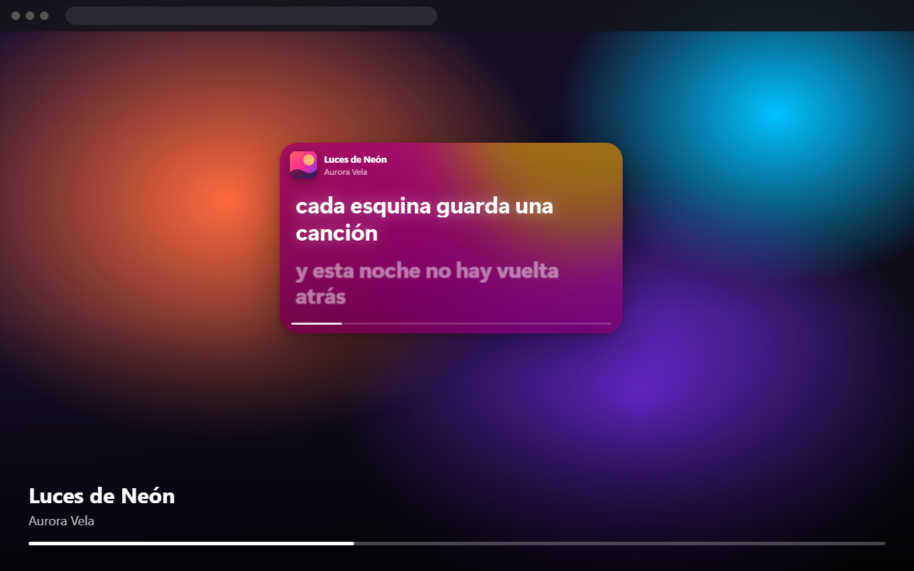
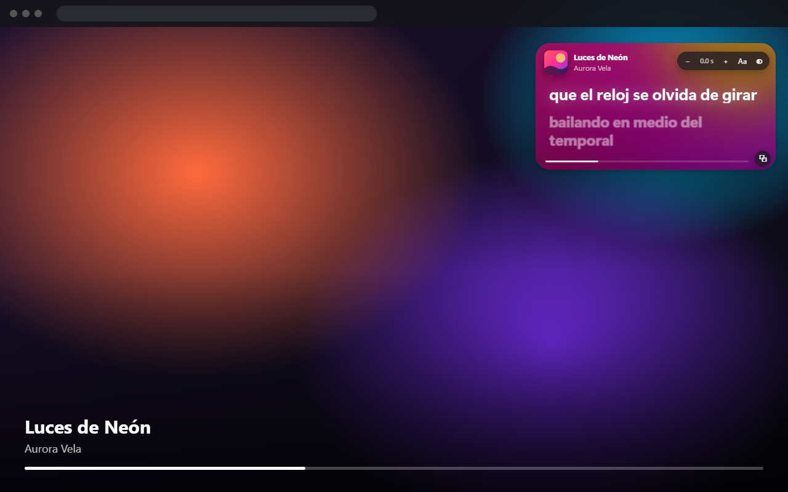
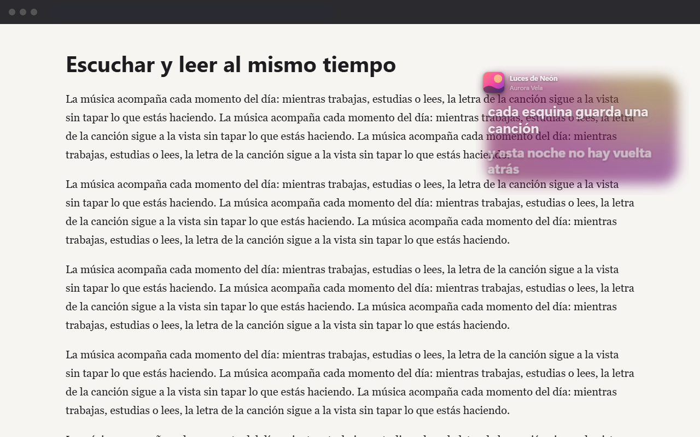

# Letras Flotantes

Extensión de Chrome que muestra la **letra sincronizada** de la música o el video que suena en el
navegador, en una tarjeta flotante con transiciones suaves: la línea actual se ilumina palabra por
palabra, la siguiente aparece debajo y el fondo toma los colores de la carátula.

Funciona con YouTube, YouTube Music, Spotify Web, SoundCloud, Deezer y la mayoría de reproductores web.



## Funciones

- **Letra en tiempo real** con resaltado palabra por palabra y pausas instrumentales animadas.
- **Siempre visible:** la tarjeta aparece encima de todas las pestañas (incluso sobre videos en
  pantalla completa) hasta que la ocultas.
- **Ventana flotante (`⧉`):** pasa la letra a una ventana Picture-in-Picture que queda encima de todo,
  aunque minimices Chrome o uses otra aplicación u otra cuenta.
- **Modo transparente (`◐`):** el fondo queda al 40 % con bordes difuminados para ver la página detrás;
  la letra se mantiene legible. Al pasar el mouse vuelve a la normalidad.
- **Ajuste de sincronía** (`−` / `+`, pasos de 0,5 s, se guarda por canción) y **3 tamaños de texto** (`Aa`).
- **Clic en una línea** para saltar a ese momento de la canción.
- **Tamaño y posición constantes:** no le afecta el zoom de la página ni la barra de desplazamiento.
- Ignora los **anuncios** de YouTube y sigue correctamente el cambio de canción en listas, mixes y
  reproducción continua de YouTube Music.

| Controles | Modo transparente |
|---|---|
|  |  |

## Instalación

### Desde el código (modo desarrollador)

1. Descarga este repositorio (**Code → Download ZIP**) y descomprímelo.
2. Abre `chrome://extensions` y activa **Modo de desarrollador** (arriba a la derecha).
3. Pulsa **Cargar descomprimida** y elige la carpeta **`letras-flotantes`**.
4. (Opcional) Fija el ícono en la barra de Chrome.

## Uso

- **Mostrar u ocultar:** clic en el ícono de la extensión o `Alt+Shift+L`.
- **Mover la tarjeta:** arrastra desde la cabecera; la posición se recuerda.
- **Controles:** aparecen al pasar el mouse sobre la tarjeta.

## Cómo funciona

| Archivo | Qué hace |
|---|---|
| `letras-flotantes/src/media-main.js` | Lee en la página qué suena (Media Session, elementos `<audio>`/`<video>`) y el tiempo de la canción. |
| `letras-flotantes/src/media-bridge.js` | Comunica la página con el service worker. |
| `letras-flotantes/src/background.js` | Elige la pestaña que suena y busca la letra en [LRCLIB](https://lrclib.net), con NetEase Cloud Music como respaldo. |
| `letras-flotantes/src/overlay.js` | Dibuja la tarjeta y la ventana flotante, y anima la letra. |

## Privacidad

Solo mientras la tarjeta está activada, se envían el **título, el artista y la duración** de la canción
a LRCLIB (y, si no responde, a NetEase) para buscar la letra. No se recopilan datos personales ni el
historial, y no hay analíticas ni publicidad. Las preferencias se guardan solo en tu navegador.

Política completa: [`docs/index.html`](docs/index.html).

## Limitaciones

- Chrome no permite extensiones en páginas `chrome://` (incluida la Nueva pestaña) ni en la Chrome Web Store.
- Si una canción no está en LRCLIB ni en NetEase, se muestra «No se encontró la letra».
- En videos oficiales con introducción larga, la letra (de la versión de audio) puede ir adelantada;
  se corrige con `−` / `+`.

## Estructura del repositorio

```
letras-flotantes/   La extensión (lo que se carga en Chrome y se empaqueta para la tienda)
docs/               Política de privacidad (publicable con GitHub Pages)
tienda/             Recursos para la Chrome Web Store: capturas, mosaico y textos de la ficha
```

## Licencia

[MIT](LICENSE) © 2026 Jorge Angulo
